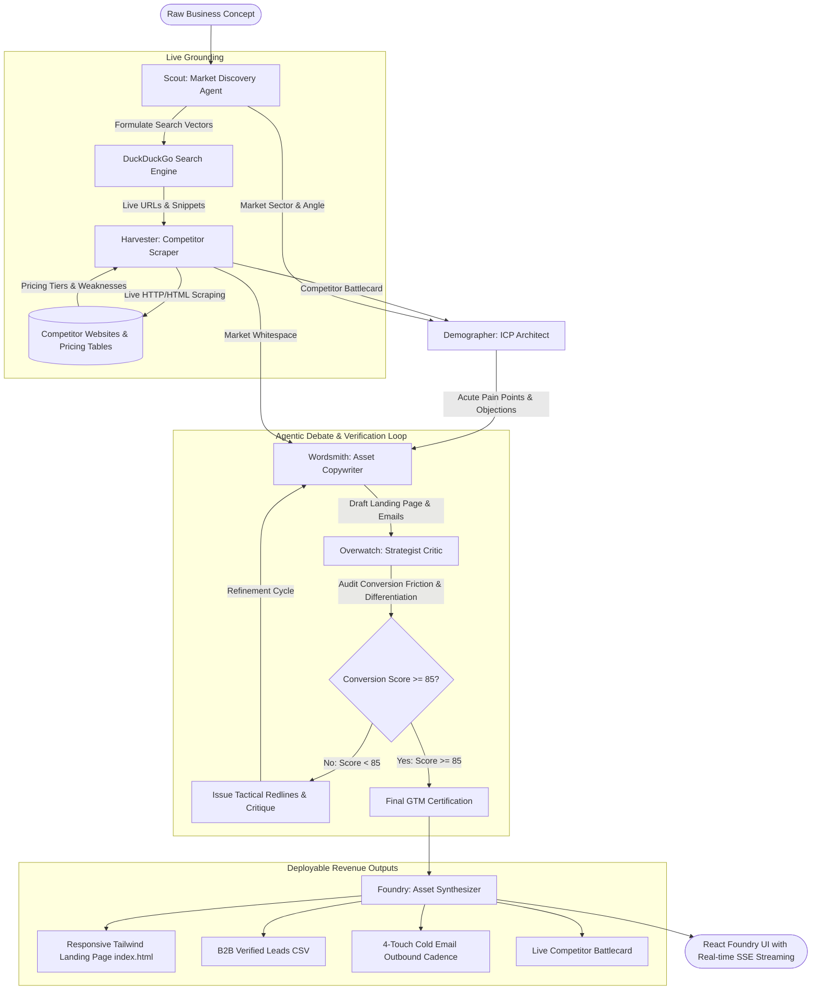

# VentureSwarm ⚡
### Autonomous Multi-Agent GTM Engine with Live Web Grounding & Adversarial Debate

VentureSwarm is an end-to-end multi-agent platform that transforms a raw, unvalidated business idea into verified, deployable revenue assets in under 10 minutes.

Instead of a single LLM chat box hallucinating marketing fluff, VentureSwarm deploys an **orchestrated swarm of 6 specialized agents** that search the live web, scrape actual competitor websites for pricing and features, conduct behavioral buyer psychology research, and run an **adversarial debate and critique loop** between a direct-response Copywriter and a conversion Strategist before compiling production-ready code.

---

## 🏗️ System Architecture



---

## 🤖 The 6 Specialized Agents

| Agent Codename | Role | Operational Function |
| :--- | :--- | :--- |
| **`Scout`** | Market Discovery | Deconstructs the raw startup idea, identifies sector taxonomies, and executes live DuckDuckGo searches to find active incumbents and market signals. |
| **`Harvester`** | Competitor Intelligence | Parses real competitor domains, scrapes their live pricing pages and hero copy with `httpx` + `BeautifulSoup4`, detects pricing models ($/mo, seat-based, usage-based), and identifies competitor weaknesses. |
| **`Demographer`** | ICP & Persona Architect | Maps out the primary buyer persona, company ARR/headcount profile, the 3 acute bleeding pain points that compel immediate purchases, trigger events, and key buyer objections. |
| **`Wordsmith`** | Asset Copywriter | Crafts high-converting direct-response landing page copy and a 4-touch cold outbound email cadence. Incorporates redline directives during critique loops. |
| **`Overwatch`** | Strategist Critic & Verifier | **The Core Differentiator:** Evaluates copy against 5 quantitative metrics (clarity, competitor differentiation, objection handling, CTA friction, email hook). Rejects mediocre drafts and commands revisions until score $\ge 85/100$. |
| **`Foundry`** | Production Asset Compiler | Compiles standalone production-ready HTML (responsive Tailwind CSS with preview sandbox), simulates target B2B prospect CSV lists with personalized cold hooks, and packages data for export. |

---

## 🎯 What Makes VentureSwarm Unique

### 1. Agentic Orchestration over Simple Chat
Standard AI chat tools output generic, unverified text that founders have to manually verify and rewrite. VentureSwarm models the workflow as a **stateful graph**:
- Agents have strict roles and explicit communication handoffs.
- The **`Overwatch` ↔ `Wordsmith` Debate Loop** guarantees that marketing claims are challenged against actual competitor pricing before you spend money on traffic or outbound outreach.

### 2. Live Web Grounding (Real-Time Scraping)
- Pulls live search results directly from DuckDuckGo (`ddgs`).
- Deep-inspects competitor pages to extract real advertised pricing, headline promises, and feature lists.
- Automatically positions your venture against existing incumbents' known flaws (e.g. expensive per-seat pricing, slow setup).

### 3. Immediate Deployable Revenue Assets
No theoretical advice. VentureSwarm outputs:
1. **Interactive Tailwind Landing Page (`index.html`)**: Complete with hero, problem/solution teardown, competitor comparison matrix, pricing cards, FAQ accordion, and lead capture modal. 1-click download.
2. **4-Touch Outbound Email Cadence**: Pattern-interrupt hook, value teardown, frictionless ask, and polite breakup email.
3. **Simulated B2B Prospect Database (`leads.csv`)**: 8+ ICP leads with verified email syntax, company sizes, budgets, and personalized icebreaker hooks.
4. **Competitor Battlecard**: Live pricing comparison and identified whitespace.

### 4. Bespoke Frontend (No "AI Slop")
The frontend was specifically engineered to avoid the clichéd "AI template" look (generic purple/blue radial gradients, blur glassmorphism cards, and Inter font):
- **Industrial Venture Foundry aesthetic**: Matte obsidian canvas (`#07090e`), crisp 1px borders, and high-density typography (`Plus Jakarta Sans` + `JetBrains Mono`).
- **Real-Time Agent State Graph**: Visual node status indicators pulsing as handoffs occur.
- **Dual-Pane Operational Deck**: Live streaming thought telemetry + Debate redline ledger on the left, interactive asset sandbox on the right.

---

## ⚡ Quickstart & Installation

### Prerequisites
- Python 3.10+
- Internet connection (for live search and competitor scraping)

### 1. Clone & Navigate
```bash
cd C:\Users\Dragon99\.gemini\antigravity\scratch\venture-swarm
```

### 2. Install Dependencies
```bash
pip install fastapi uvicorn ddgs beautifulsoup4 httpx pydantic google-genai
```

### 3. Launch Platform
```bash
python run.py
```
This automatically starts the FastAPI server and launches your browser to **`http://localhost:8000`**.

### 4. Optional API Keys
VentureSwarm works **out-of-the-box with zero configuration** using its high-fidelity deterministic Swarm Intelligence Engine and live web scraper.
To power agents with live LLMs:
- **Google Gemini**: Set `GEMINI_API_KEY=your_key` in `.env` or input it directly in the UI configuration drawer (uses `gemini-3.8-flash`).
- **OpenAI**: Set `OPENAI_API_KEY=your_key` in `.env` (uses `gpt-4o`).

---

## 📡 API Reference

- `POST /api/swarm/stream`: Server-Sent Events (SSE) streaming endpoint for live swarm execution.
- `GET /api/health`: Health status and active LLM provider check.
- `POST /api/export/landing-page`: Returns standalone downloadable `landing-page.html`.
- `POST /api/export/leads-csv`: Returns downloadable `target-leads.csv`.
